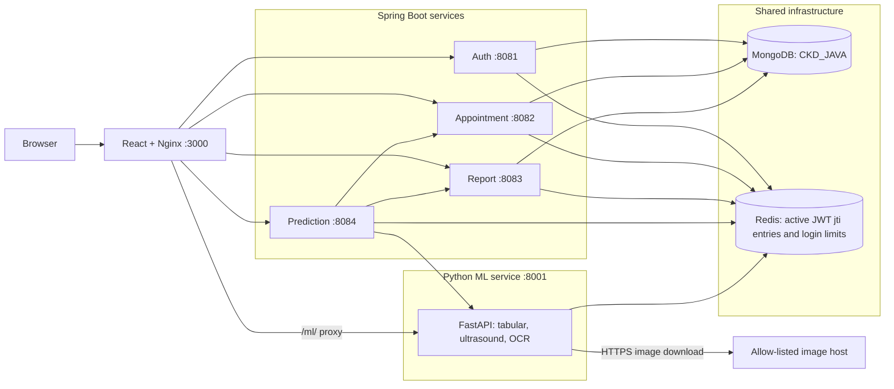

# CKD Platform

[](https://github.com/Sai-Rohan005/Chronic_Kidney_Disease_Platform/actions/workflows/tests.yaml)
[](docs/testing.md)
[](pom.xml)

A research prototype for multimodal chronic kidney disease (CKD) prediction using
clinical tabular records and kidney ultrasound images. It links patients, assigned
doctors, appointments, model calls, and stored reports. The implemented pipeline
combines modality probabilities into a binary CKD/No CKD result; its clinical
accuracy has **not been established** by the available repository evidence.

> **Medical disclaimer:** This project is for research and software demonstration.
> It is **not a medical device** and must not be used to diagnose, rule out, triage,
> or treat CKD, or to replace a qualified clinician's judgment. Software tests,
> seeded examples, and model outputs do not establish clinical safety or efficacy.

**Evaluation status:** no verified held-out datasets, patient-linked splits, or
study images were found in the evaluation audit. Tabular artifacts are present;
the image checkpoints are missing. All reported performance metrics remain
**Not computed**. See [ML evaluation](services/ml-service/docs/ml_evaluation.md)
and the [known limitations](#known-limitations) before running the system.

## Architecture

The backend comprises four Java 21/Spring Boot applications built with Maven.
Python/FastAPI hosts the Torch models and OCR route. React/Vite builds the frontend,
served by Nginx in Compose. Arrows below show HTTP calls or data access; MongoDB
and Redis do not initiate model calls.



Auth, Appointment, and Report use the same Mongo database; Report reads appointment
ownership directly from its shared `appointments` collection. Prediction obtains appointment data and persists
results through service clients. All four Java applications use
[`shared-auth`](shared-auth/src/main/java/com/ckd/auth); Python implements the same
JWT/Redis trust contract. Nginx provides same-origin proxying, not a dedicated API
gateway with centralized authorization policy.

## Prediction flow

This is the server orchestration implemented in
[`CkdPredictionService`](services/prediction-service/src/main/java/services/CkdPredictionService.java).
It requires a valid appointment, compatible model responses, and loaded ML assets.
The real frontend/Python contract gaps listed below still need resolution.

```mermaid
sequenceDiagram
    actor Doctor
    participant Web as Frontend / Nginx
    participant P as Prediction
    participant Redis
    participant A as Appointment
    participant R as Report
    participant DB as MongoDB
    participant ML as FastAPI models
    Doctor->>Web: Submit appointment_id with Bearer token
    Web->>P: POST /predictions?force=false + X-Request-Id
    P->>Redis: Check active jti after local JWT verification
    Note over P: Require Doctor; normalize ID; acquire local appointment lock
    P->>A: GET /appointments/{id}, forward token and request ID
    A->>DB: Fetch appointment and check ownership
    DB-->>A: clinical_data, ultrasound_data, assignment
    A-->>P: Appointment data
    Note over P: Verify the Doctor is assigned
    P->>R: GET /reports/{id}, forward token and request ID
    R->>DB: Authorize against appointment and find report
    DB-->>R: Existing report or absent
    R-->>P: Report or 404
    alt Report exists and force is false
        P-->>Web: Return saved report
    else New prediction or force=true
        Note over P: Validate clinical data and allow-listed HTTPS image URLs
        P->>ML: POST /routes/tab_predict with caller token and request ID
        ML-->>P: Tabular model response
        Note over P,ML: Image branches illustrate bounded concurrent calls for the supplied URLs
        par Image request A
            P->>ML: POST /routes/unet_predict
            ML-->>P: Image response A
        and Other image requests
            P->>ML: POST /routes/unet_predict
            ML-->>P: Other image responses
        end
        Note over P: Validate probabilities; average images; fuse modalities; apply threshold
        alt Report existed before forced computation
            P->>R: PATCH /reports/{id} with prediction fields
        else No report existed
            P->>R: POST /reports with appointment_id and prediction fields
        end
        R->>DB: Authorize and persist under unique appointment_id index
        alt Write succeeds
            DB-->>R: Stored report
            R-->>P: Report envelope
        else Concurrent create finds an existing report or duplicate key
            DB-->>R: Creation conflict
            R-->>P: 409 Conflict
            alt force=true
                P->>R: PATCH /reports/{id}
            else force=false
                P->>R: GET /reports/{id}
            end
            R->>DB: Authorize and read or update winner
            DB-->>R: Authoritative report
            R-->>P: Authoritative report
        end
        P-->>Web: Report envelope and available fusion metadata
    end
    Web-->>Doctor: Display response
    Note over A,ML: Each receiving service independently validates the forwarded JWT against Redis
```

The image modality probability is the mean of its image CKD probabilities.
The fused probability is `(w_tabular * p_tabular + w_image * p_image) /
(w_tabular + w_image)`. Defaults are **0.5 / 0.5 weights** and a **0.5 threshold**;
`combined_probability >= threshold` produces the `CKD` label. These are source
configuration defaults, not validated operating points or learned weights.

Existing reports are reused unless `?force=true`; force updates prediction fields.
A unique report index prevents duplicate documents, and an insert conflict returns
the winning report or updates it for force. Per-appointment locks coordinate one
Prediction instance; multiple instances can still perform duplicate ML computation.
Image failures abort the new prediction without saving an incomplete result.
Resilience4j bounds calls, retries eligible reads/pure inference calls with
exponential backoff, and opens circuits on failures. Report writes are not retried.
Temporary unavailability/timeouts map to 503; invalid upstream data/other server
failures map to 502. See [HTTP contracts](services/prediction-service/docs/service-contracts.md).

## API reference

`Bearer` means `Authorization: Bearer <token>`. Supported token roles are exactly
`Patient` and `Doctor`. Ownership is checked in service methods using the validated
principal, not an email supplied as proof of identity. Paths are case-sensitive.
The tables describe server routes, not every current frontend caller.

### Auth — port 8081

| Method | Path | Auth | Role / scope |
| --- | --- | --- | --- |
| POST | `/auth/register` | Public | Creates Patient; submitted roles cannot grant Doctor |
| POST | `/auth/login` | Public, rate-limited | Existing Patient or Doctor credentials |
| POST | `/auth/logout` | Bearer | Patient or Doctor; revoke presented token |
| POST | `/auth/change-password` | Bearer | Patient or Doctor; authenticated self |
| POST | `/auth/getRole` | Bearer | Patient or Doctor; requested email must be self |
| POST | `/auth/getUser` | Bearer | Patient or Doctor; requested email must be self |
| GET | `/auth/getRoleByToken` | Bearer | Patient or Doctor; token identity |
| GET | `/auth/getUserByToken` | Bearer | Patient or Doctor; token identity |
| GET | `/auth/getUserAndRole` | Bearer | Patient or Doctor; token identity |
| GET | `/auth/getAllDoctors` | Bearer | Patient or Doctor; explicit booking-directory fields |

Source: [AuthController](services/auth-service/src/main/java/controllers/AuthController.java)
and [UserService](services/auth-service/src/main/java/services/UserService.java).

### Appointment — port 8082

| Method | Path | Auth | Role / scope |
| --- | --- | --- | --- |
| POST | `/appointments` | Bearer | Patient; book for own `patient_email` |
| GET | `/appointments` | Bearer | Patient's own appointments or Doctor's assigned appointments |
| GET | `/appointments/{id}` | Bearer | Owning Patient or assigned Doctor |
| POST | `/appointments/updateAppointment` | Bearer | Owning Patient or assigned Doctor; supported fields only |
| GET | `/appointments/images?patient_email=...` | Bearer | Patient; own email only |
| GET | `/appointments/uploads?patient_email=...` | Bearer | Patient; own email only |

The update body uses `appointmentID`, `field`, and `value`; its controller currently
casts `value` to a string. The images/uploads endpoints read query parameters,
not GET bodies. See the upload/completion limitation below.
Source: [AppointmentController](services/appointment-service/src/main/java/Controllers/AppointmentController.java)
and [AppointmentService](services/appointment-service/src/main/java/services/AppointmentService.java).

### Report — port 8083

| Method | Path | Auth | Role / scope |
| --- | --- | --- | --- |
| POST | `/reports` | Bearer | Assigned Doctor; create for `appointment_id` |
| GET | `/reports/{appointmentId}` | Bearer | Owning Patient or assigned Doctor |
| POST | `/reports/getReport` | Bearer | Owning Patient or assigned Doctor; body has `appointmentId` |
| PATCH | `/reports/{appointmentId}` | Bearer | Assigned Doctor; update allowed report fields |

Report authorizes against the current associated appointment in Mongo, rather
than ownership claims in submitted report JSON.
Source: [ReportController](services/report-service/src/main/java/Controllers/ReportController.java)
and [ReportService](services/report-service/src/main/java/services/ReportService.java).

### Prediction — port 8084

| Method | Path | Auth | Role / scope |
| --- | --- | --- | --- |
| POST | `/predictions?force=false` | Bearer | Doctor assigned to the appointment; body has `appointment_id` |

`force` is optional and defaults to false.
Source: [PredictionController](services/prediction-service/src/main/java/Controllers/PredictionController.java).

### ML — port 8001

| Method | Path | Auth | Role / scope |
| --- | --- | --- | --- |
| POST | `/routes/tab_predict` | Bearer | Doctor; tabular inference |
| POST | `/routes/unet_predict` | Bearer | Doctor; image URL inference |
| POST | `/routes/extract_text` | Bearer | Doctor; uploaded-file OCR |
| GET | `/` | Bearer | Doctor; root response used by the authenticated health probe |

The app-wide Python middleware protects all HTTP routes, including FastAPI's
built-in documentation routes. ML checks the Doctor role; appointment assignment
is enforced by Prediction/Appointment/Report, not by an appointment context in the
raw ML routes. The duplicate decorator on `tab_predict` does not define a second
API path. Source: [ML app](services/ml-service/main.py),
[security middleware](services/ml-service/security.py), and [routes](services/ml-service/routes).

### Frontend and operational endpoints

| Service / listener | Method | Path | Auth | Role / scope |
| --- | --- | --- | --- | --- |
| Frontend, host port 3000 | GET | `/`, `/login`, `/layout`, `/profile`, `/chat` | Public static SPA | API data still requires its endpoint's token/role |
| Frontend | GET | `/healthz` | Public | Static readiness probe |
| Every Java management listener | GET | `/actuator/health`, `/actuator/health/**` | No JWT on private management port | Operational probe; details hidden |
| Every Java management listener | GET | `/actuator/metrics`, `/actuator/metrics/**` | No JWT on private management port | Operational metrics |
| Every Java management listener | GET | `/actuator/prometheus` | No JWT on private management port | Prometheus scrape |

Management ports are Auth **9081**, Appointment **9082**, Report **9083**, and
Prediction **9084**. Host runs bind management to loopback; Compose exposes it
only inside the container network. Other management paths are denied. Application
ports retain JWT protection and do not mount those operational endpoints. Nginx
proxies API routes without making them public; `/ml/` strips that prefix before
forwarding to ML. Sources: [Nginx config](frontend/nginx.conf),
[React routes](frontend/src/App.jsx), and
[security configuration](shared-auth/src/main/java/com/ckd/auth/SecurityAutoConfiguration.java).

## Security model

- **Shared Java filter chain:** `SecurityFilterChain` and `JwtBearerFilter` validate
  signed JWTs, expiration, subject, `jti`, and supported role; the validated identity
  and role enter `SecurityContext`. No HTTP session authenticates subsequent calls.
- **Redis-backed active-token allowlist:** Auth stores the exact token at
  `auth:token:<jti>` with a 60-minute TTL. Logout deletes that entry. Every protected
  request checks Redis; missing entries and Redis validation failures deny access.
  This is an allowlist, not a list of revoked token IDs.
- **Public application routes:** only Auth's login/register POSTs are public.
  Frontend static files and private management probes have the separate access
  boundaries described above. ML requires Doctor for every HTTP route.
- **Authorization:** Patients access their own appointments/reports; Doctors access
  assigned appointments/reports. Only assigned Doctors may invoke prediction and
  write reports. Email-based user lookups are self-only; the doctor directory
  exposes an explicit field list. Public registration always creates Patient.
- **Credentials:** jBCrypt hashes passwords. Registration/password changes require
  at least 12 Unicode code points and at most 72 UTF-8 bytes. `JWT_SECRET` must be
  canonical base64 encoding at least 32 random bytes; missing, malformed, and short
  keys fail startup. All participating services share this symmetric trust secret.
- **Login throttling:** Auth uses an atomic Redis counter, defaulting to 5 attempts
  per direct client IP per 60 seconds. Limits are configurable; excess requests
  return 429. Arbitrary `X-Forwarded-For` values do not establish a client identity;
  clients behind a proxy may share a quota.
- **Internal requests:** Prediction forwards the caller's token and `X-Request-Id`
  to Appointment, Report, and ML. There are no unauthenticated internal API bypasses.
  Worker tasks propagate and clear security/MDC context. The chain disables form
  login, HTTP Basic, cookie/session authentication, and CSRF checks; it expects
  explicit Bearer headers.
- **Input/logging boundaries:** ultrasound URLs require HTTPS and an exact allowed
  host, default `res.cloudinary.com`. The Python downloader rejects redirects and
  local paths. Structured request logs contain operational fields and correlation
  IDs; patient payloads, token headers, and exception text are excluded from the
  application's request/error logging paths.

Errors use `{timestamp, status, error, message, path}`. Missing/invalid/revoked
credentials return 401; authenticated role/ownership failures return 403.
The [token-validation ADR](docs/adr/001-token-validation.md) records the trust boundary.

## Run locally

Requirements: Docker with Compose; Python 3 for secret generation and seeding;
trusted ML assets for the full stack. Published application/UI ports bind to
`127.0.0.1`; Mongo, Redis, and management ports are not published.

```sh
cp .env.example .env
```

Generate the initially blank secrets without printing them:

```sh
python3 - <<'PYCONFIG'
from pathlib import Path
import base64, secrets
path = Path('.env')
text = path.read_text()
for key in ('MONGO_PASSWORD', 'REDIS_PASSWORD', 'GRAFANA_ADMIN_PASSWORD',
            'DEMO_PATIENT_PASSWORD', 'DEMO_DOCTOR_PASSWORD'):
    text = text.replace(key + '=\n', key + '=' + secrets.token_hex(24) + '\n')
text = text.replace('JWT_SECRET=\n', 'JWT_SECRET=' + base64.b64encode(secrets.token_bytes(32)).decode() + '\n')
path.write_text(text)
path.chmod(0o600)
PYCONFIG
```

Keep `.env` private and untracked. Mongo passwords generated above are hexadecimal
and safe for the Compose URI interpolation. Existing persistent Mongo/Grafana
users are not reset just by editing initialization passwords.

Set `ML_MODELS_PATH` in `.env` to an existing directory containing:

```text
tab_binary_8/ordinal_encoder_fold1_5.pkl
tab_binary_8/scaler_fold1_5.pkl
tab_binary_8/tabtransformer_fold1_5_best.pth
transunet_kidney.pth
ckd_classifier_resnet50_2_2.pth
```

These files are mounted read-only at `/models`. The checkout's tabular artifacts
do not supply the missing image checkpoints. First-start OCR/pretrained components
may also download external assets. The default ML platform is `linux/amd64`;
ARM hosts need compatible emulation and native-library validation.

```sh
docker compose config --quiet
docker compose up --build -d
docker compose ps
./scripts/seed.sh
```

Full startup waits for healthy dependencies; missing ML assets prevent ML,
Prediction, and Frontend from becoming ready. To inspect only the available API
layer without ML, use:

```sh
docker compose up --build -d mongo redis auth appointment report
./scripts/seed.sh
```

Open [the frontend](http://localhost:3000) after the full stack is ready. Demo
emails/passwords are defined in private `.env`; there are no committed default
passwords. The seed registers users through Auth, verifies credentials for existing
accounts, promotes only the configured demo Doctor through Mongo admin access,
and upserts one marked appointment. Repeated runs preserve the existing demo
appointment. Clinical values are fictional; no diagnosis is seeded.
Set a real allowed `DEMO_ULTRASOUND_URL` before the first seed if needed; an empty
image list cannot be used for prediction. Normal login throttling still applies.

Optional monitoring:

```sh
docker compose --profile observability up -d
```

[Prometheus](http://localhost:9090) and [Grafana](http://localhost:3001) use Compose
DNS and the provisioned request-rate, error-percentage, and p95 latency dashboard.
`X-Request-Id` ties JSON logs across Java and ML. Micrometer timers cover prediction
total, appointment fetch, each model invocation, and report store/update. These
are operational measurements, separate from model-performance metrics.
`docker compose down` preserves volumes; `--volumes` deletes this stack's data.
See [deployment](docs/deployment.md) and [observability](docs/observability.md).

## Tests, CI, and coverage

Java test runs generate signing keys; no configured runtime JWT secret is needed.
Use Java 21 and Maven:

```sh
mvn clean verify
mvn -Pdocker-integration clean verify
python3 -m unittest discover -s scripts/tests -v
```

The first Maven command runs unit, security, HTTP/WireMock, and real-listener
startup contracts, generates JaCoCo HTML/XML/CSV reports, and enforces per-module
line/branch gates. The Docker profile additionally starts real MongoDB, Redis,
and packaged Java services with WireMock replacing external ML. It fails when
Docker is unavailable. Model outputs in software tests are controlled fixtures.
The former empty `contextLoads` classes have been removed.

Lightweight Python tests (no Torch weights required):

```sh
python3 -m venv /tmp/ckd-tests
/tmp/ckd-tests/bin/python -m pip install fastapi 'PyJWT>=2.10.1,<3' 'redis>=5,<8' httpx requests
/tmp/ckd-tests/bin/python -m unittest discover -s services/ml-service/tests -v
```

Reports are under each Java module's `target/site/jacoco/`. The increase-only
coverage ratchet and measured baselines are documented in [testing](docs/testing.md).
[GitHub Actions](.github/workflows/tests.yaml) is configured to run the full Maven/
Testcontainers/JaCoCo build, upload coverage and JUnit artifacts, run Python/tooling
tests, then build six application images. Image publishing is disabled. Badges
reflect the workflow, not clinical validation or a fabricated coverage percentage.

## Model evaluation

The following table is copied verbatim from
[`services/ml-service/docs/ml_evaluation.md`](services/ml-service/docs/ml_evaluation.md).

| Comparison | Accuracy | Precision | Recall | F1 | ROC-AUC | PR-AUC | Confusion matrix | Brier score |
| --- | --- | --- | --- | --- | --- | --- | --- | --- |
| Tabular only | Not computed | Not computed | Not computed | Not computed | Not computed | Not computed | Not computed | Not computed |
| Image only | Not computed | Not computed | Not computed | Not computed | Not computed | Not computed | Not computed | Not computed |
| Fusion (mean) | Not computed | Not computed | Not computed | Not computed | Not computed | Not computed | Not computed | Not computed |
| Learned/weighted fusion | Not computed | Not computed | Not computed | Not computed | Not computed | Not computed | Not computed | Not computed |

The audit found no verified datasets, notebooks, patient-linked held-out splits,
or study images. Dataset source, sample size, class balance, and split proportions
are unknown; the image pipeline checkpoints are absent. Existing stage-classifier
metadata must not be silently treated as binary CKD ground truth. Patient-level
leakage and cross-domain generalization cannot be assessed from these artifacts.

```sh
make eval
make test-eval
```

`make eval` regenerates the evidence report and machine-readable JSON and exits
**2** to signal a blocked evaluation. It computes no performance metric, downloads
no data, and trains no substitute model. `make test-eval` tests the audit, not
clinical accuracy. Learned weights, ROC/PR curves, confusion matrices, and Brier
scores require labeled held-out data; none is inferred from software fixtures.

## Design decisions and trade-offs

- **Separate services:** distinct applications/ports separate account/token handling,
  appointment operations, report persistence, and prediction orchestration. The
  Maven modules, HTTP clients, and per-image CI builds support isolated software
  tests and builds. The shared database still couples data access and schema
  changes. This structural rationale does not establish measured scalability or
  describe an independently owned database per service.
- **Redis-backed JWT revocation:** local signature checks plus direct Redis reads
  avoid an Auth introspection HTTP dependency and a positive cache's revocation
  delay. Logout takes effect on subsequent validations. Requests use no HTTP session,
  but authentication as a whole is **stateful**: it depends on active Redis entries
  and Redis availability. Every trusted service holds the symmetric secret; a
  compromised participant with allowlist-write access can mint credentials. Token
  roles remain their issuance-time snapshot until expiry/revocation. These costs
  and the authenticated-introspection alternative are recorded in the ADR.
- **Late fusion:** the implemented model APIs expose separate probability outputs,
  and Prediction combines them after inference. This retains per-modality results
  and permits configured weighting without joint feature-level training. The
  current equal-weight mean is simple to inspect; no evidence demonstrates that
  it outperforms either modality or a learned fusion on held-out patients.

## Known limitations

- **Shared database:** multiple services access the same `CKD_JAVA` collections;
  Report reads Appointment data directly. Physical data isolation and independent
  schema evolution are not established.
- **No dedicated API gateway:** Nginx serves/proxies the UI. Authentication and
  authorization are enforced independently by services; a production TLS edge
  and centralized gateway policies are not supplied by this Compose setup.
- **Unverified real-model integration:** the Java tabular client sends a `root`
  wrapper while the Python route reads feature keys at the top level. The image
  route returns a label string while the Java parser requires a numeric prediction.
  Mocked ML tests do not establish compatibility with those real handlers. See
  [CkdModelClient](services/prediction-service/src/main/java/services/CkdModelClient.java),
  [tabular route](services/ml-service/routes/tab_trans.py), and
  [image route](services/ml-service/routes/image_classification.py).
- **Frontend migration remains:** some callers use old paths such as
  `/appointments/getAppointment` and `/appointments/bookappointment`, which are
  absent from the current server mappings. See
  [PatientDashboard](frontend/src/components/PatientDashboard.jsx) and
  [DoctorDashboard](frontend/src/components/DoctorDashboard.jsx).
- **Booking completion is incomplete:** Cloudinary uploads and completion are
  commented out in AppointmentService. A reservation is created as `uploading`
  while the HTTP response says `pending`; the upload path does not complete it.
  The privileged demo seed supplies a separate fixture appointment.
- **Clinical evidence is missing:** dataset size, class balance, leakage, calibration,
  and domain shift have not been measured. There is no validated learned fusion,
  production clinical evaluation, or medical-device claim. This prototype is
  **not a medical device**.
- **Operational assumptions:** database initialization and credentials are local
  deployment choices; startup dependency checks are not continuous failover.
  Report uniqueness prevents duplicate documents, not exactly-once inference
  across replicas. Registration conflicts still reveal that an email is registered.

## Future work

These are proposed improvements, not implemented capabilities:

- Resolve Java/Python and frontend/server contract mismatches and test real model
  handlers with compatible, provenance-verified artifacts.
- Complete booking uploads, typed update requests, and the reservation lifecycle.
- Supply versioned, patient-linked datasets and split manifests; audit duplicates,
  group leakage, and preprocessor-fit boundaries; perform external validation and
  calibration. Fit learned fusion only on training/validation data before test scoring.
- Extend persisted prediction reports with model/data version provenance.
- Establish service-owned storage boundaries and reviewed schema migrations; evaluate
  a gateway/TLS edge and asymmetric signing or authenticated introspection to narrow
  the shared-secret trust boundary.
- Add privacy-preserving account onboarding/verification and stronger multi-instance
  prediction coordination where deployment requirements justify them.

## Repository map

- `shared-auth/`: shared Java JWT, authorization, and correlation filters.
- `services/`: four Spring services and the Python ML app.
- `frontend/`: React/Vite source and Nginx runtime.
- `integration-tests/`: real-service Testcontainers/WireMock flows.
- `infrastructure/`: Prometheus/Grafana configuration and dashboard.
- `scripts/`: demo provisioning and coverage ratchet tooling.
- `docs/`: deployment, observability, testing, and security decisions.
